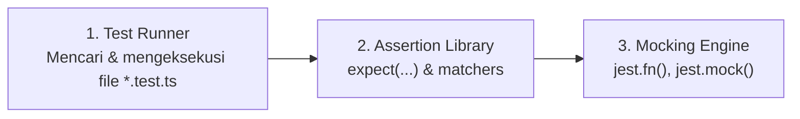
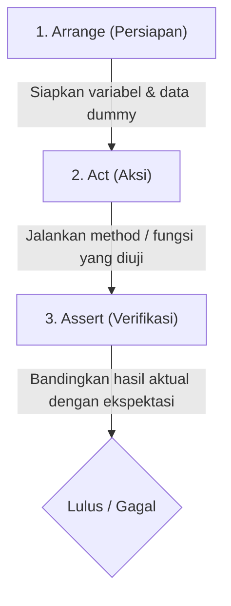
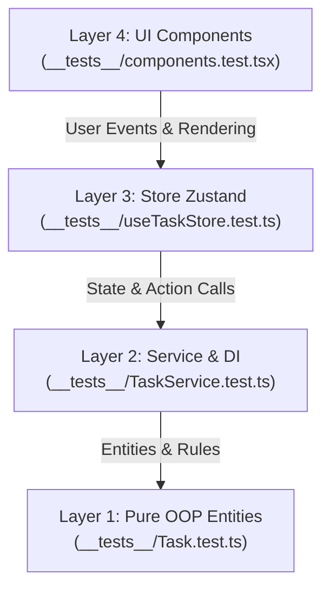
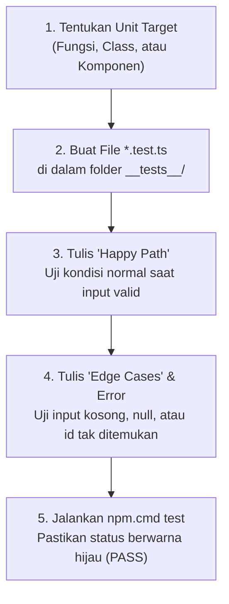

# 📖 Panduan Lengkap & Resume Memahami Jest

Project ini adalah contoh arsitektur pengujian (**Automated Testing**) modern untuk aplikasi Next.js & TypeScript. Cakupan tesnya sangat komprehensif, mulai dari pengujian unit murni berorientasi objek (**OOP Entity**), **Service & Dependency Injection (Mocking)**, **State Management (Zustand)**, hingga **UI Component (React Testing Library)**.

Dokumen ini disusun sebagai ringkasan praktis dan panduan belajar agar Anda dapat memahami Jest secara bertahap dan sistematis.

---

## 📌 Daftar Isi
1. [Konsep Dasar & Cara Kerja Jest](#1-konsep-dasar--cara-kerja-jest)
2. [Pola Pikir 3A (Arrange - Act - Assert)](#2-pola-pikir-3a-arrange---act---assert)
3. [Arsitektur Testing di Project Ini](#3-arsitektur-testing-di-project-ini)
   - [Layer 1: Pure Unit Test (Entity & OOP)](#layer-1-pure-unit-test-entity--oop)
   - [Layer 2: Service & Mocking (Dependency Injection)](#layer-2-service--mocking-dependency-injection)
   - [Layer 3: State Management (Zustand Store)](#layer-3-state-management-zustand-store)
   - [Layer 4: UI & Interaction Test (React Testing Library)](#layer-4-ui--interaction-test-react-testing-library)
4. [Cheatsheet & Kamus Kunci Jest](#4-cheatsheet--kamus-kunci-jest)
   - [Blok Struktur Pengujian](#a-blok-struktur-pengujian)
   - [Tabel Matchers Terpopuler](#b-tabel-matchers-terpopuler)
   - [Mocking & Spying](#c-mocking--spying)
5. [Cara Menjalankan Pengujian di Windows](#5-cara-menjalankan-pengujian-di-windows)
6. [Langkah Praktis Menulis Test Baru](#6-langkah-praktis-menulis-test-baru)

---

## 1. Konsep Dasar & Cara Kerja Jest

**Jest** adalah *all-in-one testing framework* buatan Meta/Facebook untuk ekosistem JavaScript & TypeScript. Jest menggabungkan 3 alat utama:



* **Test Runner**: Menginspeksi file berakhiran `.test.ts` atau `.test.tsx`, menjalankannya dalam worker thread terisolasi, dan melaporkan status `PASS` / `FAIL`.
* **Assertion Library**: Menyediakan fungsi `expect(hasilAktual).toBe(ekspektasi)` untuk membandingkan output kode dengan ekspetasi.
* **Mocking Engine**: Memalsukan modul, fungsi callback, atau network request sehingga unit test dapat berjalan cepat dan independen tanpa server/database sungguhan.

---

## 2. Pola Pikir 3A (Arrange - Act - Assert)

Setiap blok pengujian yang baik selalu membagi logika menjadi 3 tahap:



### Contoh Nyata dari [Task.test.ts](file:///c:/Users/User/work/project/unitesting/__tests__/Task.test.ts):
```typescript
it("toggle mengubah status active -> done", () => {
  // 1. Arrange (Persiapan)
  const task = new Task("1", "Belajar Jest");

  // 2. Act (Aksi)
  const status = task.toggle();

  // 3. Assert (Verifikasi)
  expect(status).toBe("done");
  expect(task.isDone).toBe(true);
});
```

---

## 3. Arsitektur Testing di Project Ini

Folder [`__tests__/`](file:///c:/Users/User/work/project/unitesting/__tests__) dirancang dalam 4 layer terpisah untuk memastikan setiap bagian aplikasi dapat diuji pada level abstraksi yang tepat:



---

### Layer 1: Pure Unit Test (Entity & OOP)
* **File Target**: [`__tests__/Task.test.ts`](file:///c:/Users/User/work/project/unitesting/__tests__/Task.test.ts)
* **Objek yang Diuji**: [`Task`](file:///c:/Users/User/work/project/unitesting/src/core/entities/Task.ts) & [`PriorityTask`](file:///c:/Users/User/work/project/unitesting/src/core/entities/Task.ts)
* **Fokus Pengujian**: Logika murni TypeScript tanpa dependensi React atau DOM.
  1. **Konstruktor & Nilai Default**: Memastikan properti awal terisi dengan benar.
  2. **Enkapsulasi & Validasi**: Memastikan exception terlempar jika title kosong (`toThrow()`).
  3. **Inheritance & Polimorfisme**: Memastikan `PriorityTask` adalah turunan dari `Task` (`toBeInstanceOf()`) dan memiliki bobot `weight` sesuai prioritas.

---

### Layer 2: Service & Mocking (Dependency Injection)
* **File Target**: [`__tests__/TaskService.test.ts`](file:///c:/Users/User/work/project/unitesting/__tests__/TaskService.test.ts)
* **Objek yang Diuji**: [`TaskService`](file:///c:/Users/User/work/project/unitesting/src/core/services/TaskService.ts)
* **Fokus Pengujian**: Aturan bisnis (Business Rules), manipulasi list, dan kalkulasi statistik.
* **Kunci Jest**: **Mocking** generator ID menggunakan `jest.fn()`:
  ```typescript
  // Membuat tiruan (test double) generator ID
  const makeMockIdGen = () => {
    let i = 0;
    return { next: jest.fn(() => `mock-${++i}`) };
  };
  ```
  > [!TIP]
  > **Mengapa ini penting?** 
  > Dengan menginjeksi mock ini ke `TaskService`, hasil ID selalu terprediksi (`"mock-1"`, `"mock-2"`), sehingga tes tidak rapuh (*flaky*) dan tidak butuh database nyata.

---

### Layer 3: State Management (Zustand Store)
* **File Target**: [`__tests__/useTaskStore.test.ts`](file:///c:/Users/User/work/project/unitesting/__tests__/useTaskStore.test.ts)
* **Objek yang Diuji**: [`createTaskStore()`](file:///c:/Users/User/work/project/unitesting/src/store/useTaskStore.ts)
* **Fokus Pengujian**: Memastikan state global berubah secara reaktif saat action dipanggil.
* **Kunci Jest**: Zustand bisa diuji langsung sebagai objek JavaScript biasa tanpa me-render komponen React:
  ```typescript
  const store = createTaskStore();
  store.getState().addTask("Belajar Zustand", Priority.High);

  const { tasks, stats } = store.getState();
  expect(tasks).toHaveLength(1);
  expect(stats.total).toBe(1);
  ```

---

### Layer 4: UI & Interaction Test (React Testing Library)
* **File Target**: [`__tests__/components.test.tsx`](file:///c:/Users/User/work/project/unitesting/__tests__/components.test.tsx)
* **Objek yang Diuji**: [`TaskForm`](file:///c:/Users/User/work/project/unitesting/src/components/TaskForm.tsx), [`TaskList`](file:///c:/Users/User/work/project/unitesting/src/components/TaskList.tsx), [`TaskStats`](file:///c:/Users/User/work/project/unitesting/src/components/TaskStats.tsx)
* **Fokus Pengujian**: Menguji perilaku komponen dari sudut pandang pengguna akhir (Black-box testing).
* **Kunci Jest & RTL**:
  1. `render(<TaskForm />)`: Memasang komponen ke simulasi browser DOM (`jsdom`).
  2. `screen.getByRole(...)` / `screen.getByLabelText(...)`: Menemukan elemen HTML berdasarkan standar aksesibilitas web.
  3. `userEvent.type(...)` & `userEvent.click(...)`: Mensimulasikan ketikan keyboard dan klik mouse pengguna secara realistis (`async/await`).
  4. `jest.mock("@/store/useTaskStore", ...)`: Mengisolasi store agar setiap tes komponen tidak tercampur state-nya.

---

## 4. Cheatsheet & Kamus Kunci Jest

### A. Blok Struktur Pengujian

| Blok Fungsi | Deskripsi | Kapan Digunakan |
| :--- | :--- | :--- |
| `describe("Judul Modul", () => {})` | Membungkus kumpulan skenario tes sejenis | Memisahkan pengujian per class, method, atau fitur |
| `it("skenario", () => {})` / `test()` | Menjalankan 1 kasus pengujian spesifik | Menjelaskan perilaku yang diharapkan secara spesifik |
| `beforeEach(() => {})` | Dijalankan **sebelum setiap** `it()` | Reset variabel, membuat instance objek baru |
| `afterEach(() => {})` | Dijalankan **setelah setiap** `it()` | Membersihkan mock, reset timer |
| `beforeAll(() => {})` | Dijalankan **sekali di awal** file tes | Setup berat (seperti inisialisasi server simulasi) |
| `afterAll(() => {})` | Dijalankan **sekali di akhir** file tes | Menutup koneksi atau membersihkan resource |

---

### B. Tabel Matchers Terpopuler

| Matcher | Kegunaan | Contoh Penggunaan |
| :--- | :--- | :--- |
| `.toBe(value)` | Cek kesetaraan nilai primitif (string, number, boolean) dengan `===` | `expect(task.isDone).toBe(true)` |
| `.toEqual(value)` | Cek kesetaraan mendalam (*deep equality*) untuk Object & Array | `expect(store.getState().tasks).toEqual([])` |
| `.toMatchObject(subset)` | Cek sebagian isi properti object tanpa harus mencocokkan semua field | `expect(task).toMatchObject({ title: "A" })` |
| `.toHaveLength(number)` | Cek jumlah elemen dalam array atau panjang karakter string | `expect(all).toHaveLength(2)` |
| `.toBeDefined()` | Memastikan variabel/hasil memiliki nilai (bukan `undefined`) | `expect(service.findById("1")).toBeDefined()` |
| `.toBeUndefined()` | Memastikan nilai kembalian adalah `undefined` | `expect(service.toggleTask("999")).toBeUndefined()` |
| `.toBeInstanceOf(Class)` | Memastikan objek dibuat dari class tertentu | `expect(task).toBeInstanceOf(Task)` |
| `.toThrow(pesan?)` | Memastikan sebuah baris kode melempar *error* | `expect(() => new Task("1", "")).toThrow()` |

> [!WARNING]
> Ketika menguji fungsi yang melempar error (`toThrow()`), Anda **harus membungkus pemanggilannya dengan fungsi panah**:
> * ✅ **Benar**: `expect(() => fungsiYangThrowError()).toThrow()`
> * ❌ **Salah**: `expect(fungsiYangThrowError()).toThrow()` *(error akan meledak sebelum Jest sempat menangkapnya)*

---

### C. Mocking & Spying

* **`jest.fn()`**: Membuat fungsi palsu (*spy function*) yang mencatat pemanggilan, argumen input, dan return value.
  ```typescript
  const mockOnClick = jest.fn();
  mockOnClick("halo");
  expect(mockOnClick).toHaveBeenCalledWith("halo");
  ```
* **`jest.mock("path/modul", ...)`**: Mengganti modul eksternal atau file impor dengan implementasi palsu secara global dalam file tes tersebut.

---

## 5. Cara Menjalankan Pengujian di Windows

Di sistem Windows PowerShell, skrip `npm.ps1` terkadang terblokir oleh *ExecutionPolicy*. Gunakan perintah `npm.cmd` atau `npx.cmd` agar dapat berjalan lancar:

```powershell
# 1. Menjalankan seluruh test suite sekaligus
npm.cmd test

# 2. Mode interaktif/watch (otomatis re-run setiap kali file disimpan)
npm.cmd run test:watch

# 3. Menghasilkan laporan persentase cakupan kode (Code Coverage)
npm.cmd run test:coverage

# 4. Menjalankan HANYA satu file spesifik (lebih cepat untuk debugging)
npx.cmd jest __tests__/Task.test.ts
```

---

## 6. Langkah Praktis Menulis Test Baru

Ikuti 5 langkah terstruktur berikut saat ingin membuat tes baru:



1. **Tentukan Unit Target**: Tentukan fungsi atau komponen apa yang ingin diuji perilakunya.
2. **Buat File Test**: Simpan di dalam folder `__tests__/` dengan akhiran `.test.ts` (atau `.test.tsx` untuk UI).
3. **Mulai dari Kasus Normal (*Happy Path*)**: Pastikan fungsi menghasilkan nilai yang benar dengan parameter yang ideal.
4. **Uji Kasus Ekstrem (*Edge Cases & Boundary*)**: Berikan input string kosong, ID yang tidak ada, atau trigger kondisi error untuk memastikan validasi berjalan sesuai rencana.
5. **Jalankan Verifikasi**: Jalankan `npm.cmd test` dan pastikan seluruh test suite lolos (**PASS**).
